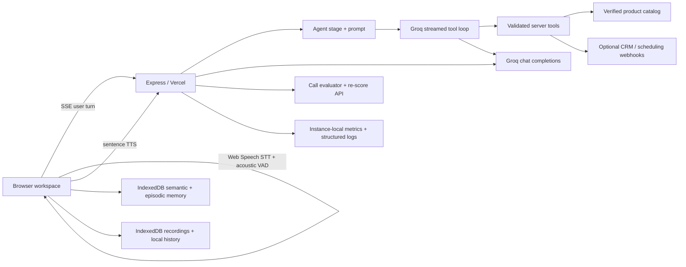

# Sankar Voice Sales Agent

A browser-based voice sales workspace built around an explicit stage-driven agent, validated Groq tool loop, acoustic turn detection, sentence-level speech, prospect memory, call evaluation, and operational telemetry.

**Live demo:** [sankar-voice-sales.vercel.app](https://sankar-voice-sales.vercel.app/)

## Architecture



The browser owns the live audio and local call archive. The server owns provider credentials, tool validation, product facts, retries, and evaluation. No transcript, recording, or prospect memory is sent to the metrics logger.

## Run locally

Requirements: Node.js 20+, a Groq API key, and Chrome or Edge for Web Speech recognition.

```powershell
npm install
Copy-Item .env.example .env
```

Set `GROQ_API_KEY` in `.env`, then:

```powershell
npm run dev
```

Open `http://localhost:3000`. Keep credentials server-side. Never put the Groq key in browser code or commit it.

## Agent behavior and tool loop

The server carries the six stages: introduction, discovery, pitch, objection handling, closing, and summary generation. Intent and turn history guide stage transitions; the LLM determines what to say within that stage. Groq tool calls run through a bounded loop (up to three tool-bearing generations and a final response generation). Arguments and results are validated before the model sees tool output. Catalog reads can execute in parallel; state-changing tools execute in request order.

Read-only product and quote tools use only `GROQ_PRODUCT_CATALOG`. Example:

```json
{"Example SaaS":{"description":"Verified product description","features":["Verified feature"],"integrations":["Verified integration"],"price":29,"currency":"USD","billing_period":"per seat per month"}}
```

Do not configure prices or claims without approval. Missing catalog facts cause the agent to say that it cannot verify the answer.

### Optional calendar and CRM adapters

The app accepts HTTPS JSON webhooks to avoid coupling the agent to one CRM/calendar vendor:

- `FOLLOWUP_WEBHOOK_URL` receives `{ requested_time, channel, notes }`. It is treated as booked only when the response is JSON containing `{ "booked": true }`; otherwise the assistant describes it as a captured request needing confirmation.
- `CRM_WEBHOOK_URL` receives `{ status, reason }` when the agent updates the lead outcome.
- `INTEGRATION_WEBHOOK_SECRET` is sent as a Bearer credential to either endpoint. Configure a receiver-side secret and use HTTPS.

The receiver must be idempotent because network retries can repeat a webhook. These adapters do not claim to be a direct Google Calendar or CRM SDK integration; connect the endpoint to an approved workflow (for example a small server-side adapter or automation service) and verify its booking response contract.

## Voice experience

The browser uses Web Speech API for STT and Groq Orpheus for server-side TTS. Responses stream over SSE; complete sentences are synthesized as soon as they arrive. Barge-in cancels the current generation and playback. An adaptive RMS acoustic VAD with onset debounce and a 420ms hangover manages turn boundaries and activity indicators. It is dependency-free and avoids shipping a large model, but it is not neural Silero VAD; noisy rooms may require a neural VAD or hosted STT adapter. The recognizer language is currently `en-IN`.

Audio is mixed and recorded in-browser only when the operator confirms prospect consent. Recordings are stored in IndexedDB; they are not uploaded to Groq. Timestamped transcript turns can seek the saved audio.

## Memory and privacy

- Short-term memory is the current transcript, bounded to 80 messages.
- Semantic facts (needs, preferences, objections, company, outcomes) have importance and confidence values, are ranked by query relevance, and decay over time.
- Episodic memory stores a compact summary/status/next-step record per call and is separately ranked and decayed.
- The previous IndexedDB profile format is migrated lazily. Memory is local to the browser and is not a secure multi-user database.

## Evaluation and analytics

After a call, Groq returns structured needs, objections, next steps, buying signals, quality flags, status, and judge dimensions: discovery, objection handling, need alignment, factuality/compliance, empathy/tone, next-step clarity, and overall effectiveness. Talk/listen ratio is calculated from transcript word counts. Saved calls can be re-scored with the current rubric. CSV export includes the local transcript and evaluation. The analytics view reports saved-call trends.

Run the deterministic, no-network regression suite:

```powershell
npm run eval:offline
```

For LLM judge replay of saved call-shaped JSON fixtures, start the app with a configured Groq key and run `npm run eval:offline -- --rescore` (optionally pass a fixture path after the flag). Set `EVAL_BASE_URL` to target another deployment. The report is written to `eval/latest-report.json` (override with `EVAL_OUTPUT`). In `--rescore` mode, transcripts are sent to the configured Groq evaluation endpoint.

## Reliability and observability

- Transient Groq failures (timeouts, rate limits, and server errors) use bounded exponential backoff with jitter. A process-local circuit breaker rejects calls during a short cooldown after repeated failures.
- Tool execution has input/output schema checks, bounded results, safe fallback messages, and structured completion/error logs.
- `/api/metrics` exposes rolling 15-minute request/error percentiles, token usage, client-reported time-to-first-token/audio, tool frequency/success, and circuit state. `/api/telemetry` accepts bounded latency samples.
- Browser analytics are persisted per call. Server metrics are in-memory and per serverless instance; Vercel may scale or recycle instances, so these are operational diagnostics, not durable aggregate observability. Use a hosted metrics/logging backend for production operations.
- `/api/health` indicates provider configuration. The local rate limiter is also process-local.

## Human control and boundaries

An operator can take over, type a response for voice playback, and hand control back to the agent; operator turns remain visible in the transcript and are included in evaluation. Product claims are constrained to verified catalog results. Scheduling is never represented as booked unless the configured webhook returns explicit confirmation.

This project is a portfolio/demo architecture, not a multi-tenant production deployment. Browser history and memory have no authentication or cross-device sync. Before a real sales deployment, add authenticated users, durable encrypted storage, tenant-scoped data access, centralized metrics, retention controls, and provider-side consent/compliance review.

## Code map

- `server.js`: Express/Vercel HTTP routes, SSE generation, provider calls, request limits.
- `agent/stages.js`, `agent/prompt.js`: stage transitions, intent, sales policy, memory injection.
- `agent/tools.js`, `agent/tool-runtime.js`: tool schemas, server handlers, validation, concurrency.
- `agent/reliability.js`, `agent/observability.js`: retries, circuit breaker, structured logs and metrics.
- `agent/evaluation.js`: normalized structured judge output and transcript-derived measures.
- `public/app.js`, `public/voice-activity.js`: call lifecycle, voice playback, VAD, operator mode, transcript/history/analytics.
- `public/memory.js`: ranked semantic and episodic IndexedDB memory with migration and decay.
- `eval/fixtures.json`, `scripts/offline-eval.js`: replay fixtures against the running evaluator.
- `api/[...path].js`: Vercel serverless adapter for Express.

## Deploy

Deploy on Vercel and configure `GROQ_API_KEY` in the server environment. Add catalog and webhook variables only when they point at approved, HTTPS integrations. Redeploy after environment changes. Microphone and recognition require HTTPS or localhost. Browser support and recognition accuracy vary.
