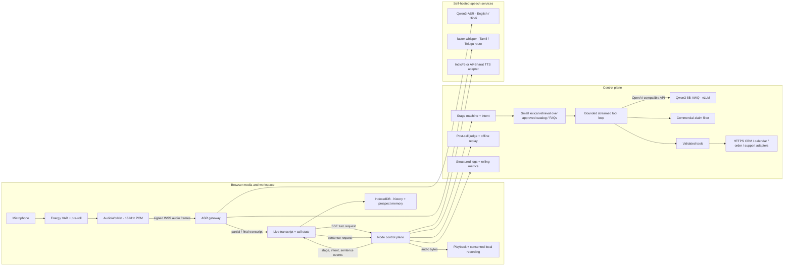

# Sankar Voice Sales Agent

A local-first, open-model voice sales agent for Indian small-business workflows. It combines a browser voice workspace with a Node control plane, a streamed Qwen agent, verified catalog tools, Indian-language speech workers, operator takeover, and call-level evaluation.

**Design target:** make the first spoken response fast, let the prospect interrupt naturally, and keep commercial claims tied to approved evidence. The `500–800 ms` first-audio range is an instrumented target, not a measured or guaranteed result. GPU hardware, model warm state, network RTT, sentence length, and the selected TTS worker all affect it.

## Architecture



The real-time media path, control plane, and durable state have separate responsibilities:

- **Media path:** the browser captures the microphone, runs an adaptive acoustic VAD, resamples PCM in an AudioWorklet, and connects to a separately hosted WSS ASR gateway. This avoids placing WebSockets or GPU inference inside a Vercel function.
- **Control plane:** Express handles SSE turns, Qwen-compatible chat calls, grounding, validation, webhook calls, summaries, and `/api/metrics`. It can run locally or as the existing Vercel adapter.
- **Storage:** transcripts, call recordings, and prospect memory stay in the browser's IndexedDB/local storage. Server telemetry is process-local and never contains transcript content.

## Open-model stack

| Capability | Included path | Notes |
|---|---|---|
| Chat and tool use | Qwen3-8B-AWQ served by vLLM | Open weights; thinking disabled in vLLM and request chat-template settings. Model calls use the OpenAI-compatible API. |
| English and Hindi STT | Qwen3-ASR-0.6B through its streaming API | Native streaming route. It does not list Tamil or Telugu in its supported language table. |
| Tamil and Telugu STT | faster-whisper `small` worker | Re-decodes voiced audio periodically for revisable partials, then finalizes at end-of-utterance. This is chunked inference, not token streaming. |
| Indic TTS | Included IndicF5 sentence worker | Open weights for Indic languages including Hindi, Tamil, and Telugu; requires a configured reference voice clip and its exact transcript. |
| Indian English and Hinglish TTS | Optional AI4Bharat Indic-TTS adapter | Set `TTS_PROVIDER=ai4bharat` and point `AI4BHARAT_TTS_URL` to a separately run compatible AI4Bharat server. The upstream project lists Indian English and Hinglish voices. |

Qwen3-8B is published under Apache-2.0; its model card documents `enable_thinking=False`, and vLLM exposes chat-template kwargs for disabling reasoning in the request path. [Qwen3 model card](https://huggingface.co/Qwen/Qwen3-8B) · [vLLM chat-template kwargs](https://docs.vllm.ai/en/v0.30.0/api/vllm/entrypoints/launchers/cli_args/) · [vLLM tool calling](https://docs.vllm.ai/en/latest/features/tool_calling/).

Qwen3-ASR supports English and Hindi but not Tamil/Telugu in its listed language set; the app routes Tamil/Telugu to a Whisper worker instead. [Qwen3-ASR supported languages and streaming setup](https://github.com/QwenLM/Qwen3-ASR). IndicF5 lists Hindi/Tamil/Telugu and other Indian languages. [IndicF5 model card](https://huggingface.co/ai4bharat/IndicF5). The optional AI4Bharat Indic-TTS path supports Indian-English and Hinglish as well as Indic languages. [AI4Bharat Indic-TTS inference docs](https://github.com/AI4Bharat/Indic-TTS/blob/master/inference/README.md).

“Free models” means model weights and software can be self-hosted without per-token API charges. It does **not** mean free GPU time, electricity, networking, storage, or model operations. Groq remains an optional hosted fallback; the default `.env.example` selects local Qwen and IndicF5.

## Latency path and voice behavior

1. RMS VAD uses adaptive noise floor, three-frame onset debounce, and a 420 ms hangover. A 200 ms AudioWorklet pre-roll protects initial consonants before speech is recognized.
2. Speech frames stream to the authenticated ASR gateway. Partial text is rendered during the utterance; silence triggers finalization and an SSE agent request.
3. The agent begins a streaming chat completion with Qwen3 thinking disabled. The first complete, policy-checked sentence is sent to the UI and starts a separate TTS request while the model continues generating later sentences.
4. The browser plays each sentence and continues to listen. On VAD onset, it synchronously pauses playback, aborts both the SSE turn and active TTS request, and discards queued/stale text.
5. The app records client TTFT, first audio byte, actual playback start, turn latency, STT finalization, and local barge-in reaction. The `/api/metrics` endpoint reports percentiles and the fraction of playback starts at or below the 800 ms target.

The speech adapters currently synthesize a whole sentence before the browser plays its WAV response. This overlaps TTS with later LLM generation, but it is **not codec-level streaming audio**. Barge-in cancels the local generation and playback request; the current metric does not measure a downstream ASR/GPU cancellation acknowledgement. Measure the target on a warm deployment with real Indian-network conditions before advertising an SLO.

## Product grounding and tools

The agent stage machine covers introduction, discovery, pitch, objection handling, closing, and summary. Intent signals can move it to an objection or close without following a rigid script.

Approved catalog facts, FAQs, policies, service levels, and integrations are chunked into small records and ranked with lightweight lexical relevance scoring. This is intentionally dependency-free and suitable for a small catalog; it is not an embedding model or general-purpose document ingestion pipeline. No evidence match means the assistant says it cannot verify the claim.

Commercial-claim filtering runs before each complete sentence is sent for speech. Price/discount claims require a catalog-grounded answer or a successful validated pricing tool result. The quote tool ignores model-supplied amounts, and quantity fields cannot authorize a price. This is a deterministic safety layer with conservative false positives; it is not a formal proof that every paraphrased feature claim is true. Review blocked claims and improve the approved source data before relaxing thresholds.

Available tools:

- `check_product_info`: return relevant catalog/document sources.
- `calculate_pricing` / `generate_quote`: calculate only from configured price data.
- `schedule_followup`: capture the prospect's request; report a booking only if the connected webhook confirms it.
- `update_lead_status`: update the outcome and optionally sync it to a CRM webhook.
- `check_order_status`: read a trusted configured order adapter.
- `create_support_ticket`: create a ticket only when the configured adapter confirms it.
- `end_call`: signal that the next step is acknowledged or the prospect clearly declined.

The model/tool loop is bounded to avoid runaway cost. Tool arguments and results are validated, safe parallel reads are grouped, writes remain ordered, and failed integrations return explicit unconfirmed states. Webhook retries carry idempotency keys.

### Catalog configuration

Set `PRODUCT_CATALOG_JSON` on the server. `GROQ_PRODUCT_CATALOG` is still accepted as a legacy alias.

```json
{
  "Nexus CRM": {
    "description": "Approved description of the product.",
    "features": ["Approved feature"],
    "integrations": ["Approved integration"],
    "faqs": [{ "question": "Can it export reports?", "answer": "Approved answer." }],
    "policies": ["Approved policy"],
    "price": 29,
    "currency": "INR",
    "billing_period": "per seat per month"
  }
}
```

Only configure commercial facts approved by the business. Product name alone is not evidence. `SALES_KNOWLEDGE_JSON` can add bounded product documents such as FAQs and policies:

```json
[{"product":"Nexus CRM","kind":"policy","source":"approved-policy-17","content":"Approved policy text."}]
```

### Business integrations

The server can call HTTPS webhook adapters; it does not ship vendor credentials or a direct Zoho, Freshdesk, WhatsApp Business, or Google Calendar SDK. Configure the relevant server variables:

- `FOLLOWUP_WEBHOOK_URL`: receives a requested callback/demo; booking is claimed only for `{ "booked": true }`.
- `CRM_WEBHOOK_URL`: receives lead status changes.
- `ORDER_STATUS_WEBHOOK_URL`: returns a trusted order status.
- `SUPPORT_TICKET_WEBHOOK_URL`: creates a support request after explicit intent.
- `HUMAN_HANDOFF_WEBHOOK_URL`: receives call context and a short handoff brief.
- `INTEGRATION_WEBHOOK_SECRET`: optional shared bearer secret for the receiver.

Use HTTPS receivers, validate their own schemas, and make them idempotent. The local operator panel works without a remote transfer system; a webhook is only reported as a transfer if it explicitly confirms the handoff.

## Run locally

### Prerequisites

- Node.js 20+
- Docker Engine with NVIDIA Container Toolkit for the included GPU profile
- Linux host is recommended for the CUDA services
- A supported NVIDIA GPU and enough memory for the models you choose

The example profile runs the Qwen3-8B AWQ server, Qwen3-ASR, Whisper, and IndicF5. It is a starting configuration, not a validated concurrency or hardware promise. The Qwen chat container reserves most GPU memory; adjust its memory utilization and the ASR/TTS services after measuring peak VRAM and queueing. A 6 GB laptop GPU will not run this full profile. A 24 GB L4/RTX 4090 class GPU is a more practical starting point, but actual fit and concurrent call count must be load-tested. Qwen continuous batching is capped to 16 sequences in the example; IndicF5 synthesis is serialized by default to protect VRAM.

### Start the open-model stack

```powershell
npm install
Copy-Item .env.example .env
# Edit .env: create a random VOICE_GATEWAY_SECRET (32+ chars).
# Add a consented reference clip at voice-refs/agent.wav and its exact transcript.
# Configure the approved PRODUCT_CATALOG_JSON before making real sales claims.
docker compose --profile voice-stack up --build
```

In another terminal:

```powershell
npm run dev
```

Open `http://localhost:3000` in a browser that supports microphone capture and AudioWorklet. The Qwen and speech model weights are downloaded on first launch and cached in the `hf-cache` Docker volume. First boot may take several minutes; do not treat cold-start latency as the warm-call latency.

For local control-plane development without Docker, set `AI_PROVIDER=groq` and `GROQ_API_KEY` on the server, or point `LLM_BASE_URL` to an already-running local OpenAI-compatible endpoint. The Groq path is optional and may incur usage charges. The browser never receives provider API keys.

### Indian English and Hinglish TTS

The included compose stack starts IndicF5 for Indic languages. To serve Indian-English/Hinglish with open weights, run an AI4Bharat Indic-TTS REST-compatible service with the required official language checkpoints, then set:

```dotenv
TTS_PROVIDER=ai4bharat
AI4BHARAT_TTS_URL=http://127.0.0.1:5050
AI4BHARAT_TTS_GENDER=female
```

The adapter maps English, Hindi, Hinglish, Tamil, and Telugu to the corresponding AI4Bharat language identifiers, bounds response size, and rejects unsupported language labels. Upstream AI4Bharat setup has older/heavier inference dependencies and checkpoint download steps; operate it as a separate, pinned service. Tanglish (Tamil-English code mixing) is not a supported voice in the configured adapters yet. Use actual per-language call recordings to evaluate pronunciation before customer rollout.

### Environment variables

| Variable | Purpose |
|---|---|
| `AI_PROVIDER` | `local` by default; `groq` is optional. |
| `LLM_BASE_URL`, `LLM_API_KEY`, `LLM_MODEL` | OpenAI-compatible local vLLM/SGLang endpoint and Qwen model. |
| `GROQ_API_KEY`, `GROQ_CHAT_MODEL` | Optional hosted chat fallback. Keep on server only. |
| `TTS_PROVIDER` | `indicf5` default; optional `ai4bharat` or hosted `groq`. |
| `INDIC_TTS_URL` | Included IndicF5 worker URL. |
| `AI4BHARAT_TTS_URL` | Optional local AI4Bharat-compatible REST server. |
| `STT_PROVIDER` | `streaming` for the self-hosted ASR workers; `browser` for Web Speech fallback. |
| `STT_WS_URL_HINDI`, `STT_WS_URL_TAMIL` | Public/private `ws://` local or `wss://` deployed ASR routes. |
| `VOICE_GATEWAY_SECRET` | Shared HMAC secret between Node and the ASR gateway; use a unique random secret. |
| `PRODUCT_CATALOG_JSON`, `SALES_KNOWLEDGE_JSON` | Approved product facts and small FAQ/policy corpus. |
| `FOLLOWUP_WEBHOOK_URL`, `CRM_WEBHOOK_URL`, `ORDER_STATUS_WEBHOOK_URL`, `SUPPORT_TICKET_WEBHOOK_URL`, `HUMAN_HANDOFF_WEBHOOK_URL` | Optional HTTPS integration adapters. |

## Operator takeover and call safety

A human can take control during a call, type a response for the configured TTS voice to speak, hear and see the prospect's next turns, then resume the agent. Explicit human requests trigger takeover. Repeated frustration or repeated user turns can also trigger a local operator takeover. A concise model-generated handoff brief and bounded transcript context can be sent to the configured transfer webhook; if summary generation fails, the system sends a marked fallback brief rather than blocking local takeover.

Operator messages are distinct transcript turns, are passed back to the agent as context, count as assistant speech in talk/listen ratios, and are included in call evaluation. This is a local browser operator console plus optional webhook signal, not a PSTN/SIP bridge or staffed call-center queue. A production deployment must connect it to an authenticated live agent system.

Recording is disabled until the operator checks the consent box. When enabled, the mixed call audio is stored in browser IndexedDB and is not uploaded by this code. Use a secure HTTPS origin outside localhost. Apply the consent, privacy, retention, access-control, and deletion rules relevant to the business and jurisdiction.

## Observability

`GET /api/metrics` returns a rolling 15-minute, current-process snapshot:

- LLM first-token latency, request/error counts, prompt/completion tokens, and circuit state.
- Client-reported time to first audio byte, playback start p50/p95, the fraction of playback starts within the 800 ms target, total-turn p50/p95, STT finalize latency, and local barge-in reaction latency.
- Call capture start/drop counts, handoff count, per-tool calls/errors/success rate/latency, and request error rates.
- Whisper mean log probability p50 as an **uncalibrated diagnostic**, not an STT confidence probability. Qwen ASR does not currently expose a comparable value.

`/api/telemetry` accepts only a small allowlist of numeric metrics and is rate-limited. `logEvent` writes structured JSON events for retries, model errors, tool completion, guardrail blocks, handoffs, turns, and speech. Logs deliberately omit transcript text, prompts, secrets, and full tool arguments.

Metrics live in process memory and reset with the process. Vercel can route requests across ephemeral instances; for a real service, export the structured events and histograms to a shared metrics backend, add trace/call correlation, and use a shared rate-limit store. The dashboard is useful for a local benchmark, not an organization-wide SLO source of truth.

## Evaluation and tests

Deterministic no-network checks:

```powershell
npm test
npm run eval:offline
```

The offline regression suite covers intent/stage behavior, memory and tool policies, evaluation normalization, retries/circuit breaker behavior, and historical fixture replay. It does not require an LLM key unless `--rescore` is requested.

Measure speech recognition on consented, manually transcribed Indian-accent recordings. Create a JSON file containing `language`, `reference`, and `hypothesis` for every finalized utterance, then run:

```powershell
npm run eval:wer -- ./path/to/asr-samples.json
```

The report includes corpus WER and a per-language breakdown. Keep separate test sets for English, Hindi, Hinglish, Tamil, Telugu, and any in-market code-switch pattern; do not compare languages using a single pooled score. WER is transcript quality only; it does not measure turn latency, interruption success, or sales safety.

After a call, the LLM judge scores discovery, objection handling, need alignment, factuality/compliance, empathy, next-step clarity, and overall effectiveness. Call history can be rescored with the current rubric. Judge scores are useful coaching signals, not objective proof of sales quality; review a human-labeled sample and audit commercial claims.

## Deployment and cost

- **Local demo / pilot:** run the Node app near the GPU workers on a private network. Keep model ports private; expose only the HTTPS app and required WSS gateway through a TLS reverse proxy.
- **Vercel control plane:** the existing Express adapter can host HTTP/SSE routes, but Vercel does not host the GPU models or the long-lived ASR WebSocket. Deploy the ASR/TTS/LLM services separately and set private service URLs/secrets in Vercel. Browser ASR needs a public `wss://` URL reachable by the user's browser.
- **Cost control:** use quantized Qwen weights, small ASR model variants, bounded tool/agent loops, concurrency caps, and business-hour scheduling. The repository does not include GPU autoscaling or scale-to-zero automation. Turning a GPU off saves compute but incurs cold model-load time; warm up and measure before accepting calls.
- **Before customer calls:** pin model/container versions, benchmark each language and network region, load-test model memory and queueing, configure authenticated CRM/handoff receivers, add centralized telemetry, and review recording/consent/privacy requirements.

## Limits and production-readiness boundary

- No benchmark in this repo demonstrates 500–800 ms first playback on a specific GPU/network. The UI and endpoint expose actual measurements; latency target attainment remains deployment-specific.
- There is no native carrier/PSTN/SIP/phone-call integration, WebRTC media server, agent queue, authentication, tenant isolation, or shared CRM database.
- The browser owns call state, local recording, and prospect memory. Clearing browser data loses that history; it does not sync across devices.
- The default ASR split covers English/Hindi with Qwen and Tamil/Telugu through Whisper. Tanglish is routed to Whisper with a Tamil language hint, but Tamil-English recognition still needs local WER testing. Hinglish recognition is not guaranteed by a Hindi/English language label.
- The default IndicF5 worker is not a validated Indian-English/Hinglish voice. Use the optional AI4Bharat service path for those languages; Tanglish is not covered by the selected open voice adapters.
- The commercial filter is intentionally conservative and pattern/evidence based. Audit claims and tool data; never use it as the only compliance control.
- Server metrics, rate limits, and circuit state are in-process. Persisted multi-instance telemetry and production alerting are deployment work.
- Open-model licenses and terms are not identical across software, weights, datasets, and voice reference recordings. Review every artifact and obtain consent before distributing or cloning a person's voice.

## Repository map

- `server.js`: Express control plane, provider calls, SSE, speech routing, tools, summary/handoff, metrics.
- `agent/provider.js`, `agent/speech-providers.js`: server-side model and TTS adapter selection.
- `agent/stages.js`, `agent/prompt.js`: stage/intent logic and live system prompt.
- `agent/knowledge.js`, `agent/guardrails.js`: approved-source retrieval and fail-closed commercial-sentence filter.
- `agent/tools.js`, `agent/tool-runtime.js`: schemas, server validation, bounded parallel tool execution, webhooks.
- `agent/reliability.js`, `agent/observability.js`: retries, circuit breakers, structured logs, bounded metrics.
- `services/qwen-asr/`: authenticated streaming ASR WebSocket gateway for Qwen3-ASR / faster-whisper.
- `services/indic-tts/`: bounded-concurrency IndicF5 synthesis worker.
- `public/app.js`, `public/voice-activity.js`, `public/pcm-capture-worklet.js`, `public/voice-turn.js`: live workspace, RMS VAD/streaming capture, playback, interruption.
- `public/memory.js`: browser-local episodic and semantic prospect memory.
- `eval/`, `scripts/`, `test/`: sales regression fixtures, ASR WER tool, unit tests, and replay scripts.
- `docker-compose.yml`: optional local GPU profile.

## License and attribution

See the repository license for application code. Qwen, Qwen3-ASR, IndicF5, AI4Bharat Indic-TTS, faster-whisper, and any voice/model artifacts retain their own licenses and usage terms. Verify each upstream license before commercial use.
